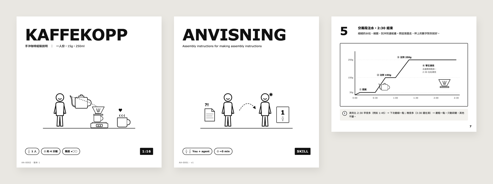
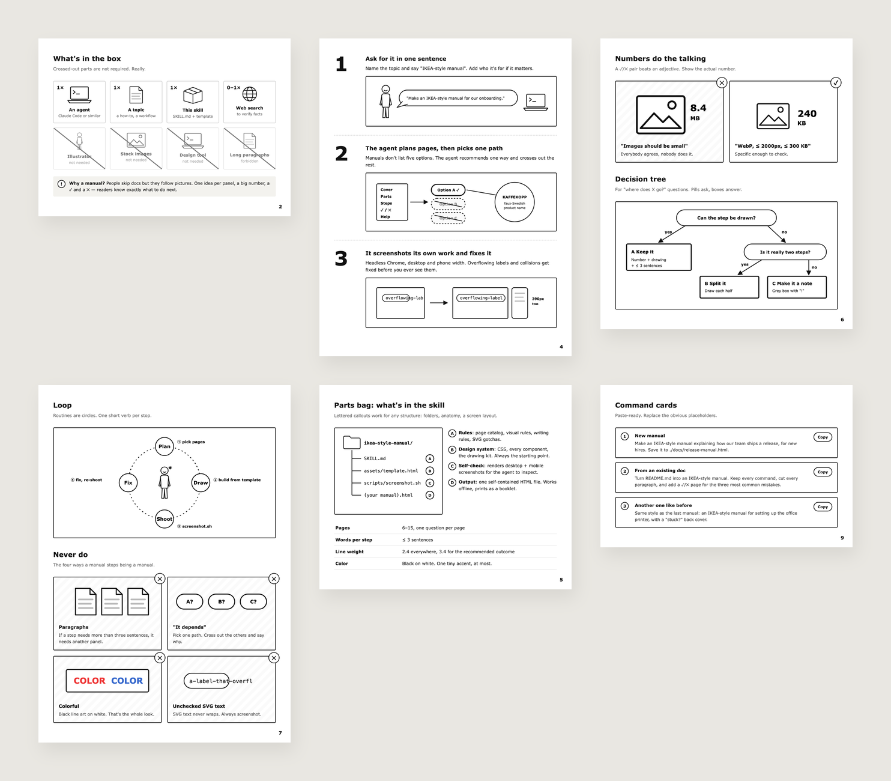
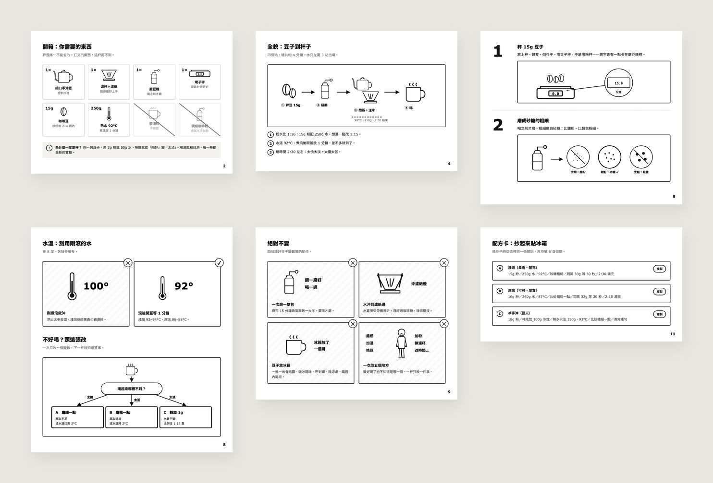

<div align="center">

# IKEA-STYLE MANUAL

**Your agent writes docs nobody reads. Make it draw assembly instructions instead.**

An agent skill that turns any how-to into an IKEA-style flat-pack manual:
line-art figures, giant step numbers, parts lists, ✓/✕ panels, and copy-ready commands,
all in **one self-contained HTML file**.

[**Live demo (English)**](https://vic-chen-160.github.io/ikea-style-manual/skills/ikea-style-manual/assets/template.html) ·
[**Live demo (繁體中文)**](https://vic-chen-160.github.io/ikea-style-manual/examples/pour-over-coffee.zh-TW.html) ·
[中文說明](README.zh-TW.md)



</div>

## Install

**Claude Code (plugin):**

```
/plugin marketplace add Vic-Chen-160/ikea-style-manual
/plugin install ikea-style-manual@ikea-style-manual
```

**Manual install** — copy the skill folder into your agent's skills directory (Claude Code shown):

```bash
git clone https://github.com/Vic-Chen-160/ikea-style-manual.git
cp -r ikea-style-manual/skills/ikea-style-manual ~/.claude/skills/
```

## Use

Just ask:

> Make an IKEA-style manual for how our team ships a release.

> Turn this README into an IKEA-style manual. Keep every command, cut every paragraph.

> 用 IKEA 說明書的方式做一份 .html：新人第一天怎麼把開發環境裝好。

The agent interrogates the topic, picks **one** recommended path (manuals don't say "it depends"),
plans the pages, names the product in faux-Swedish (`KAFFEKOPP`, `ANVISNING`, `FLYTTA`…),
builds it, then **screenshots its own work** at desktop and phone width and fixes anything that overflows.

## What's in the box



| Page | What it's for |
|---|---|
| Cover | Product name, hero drawing, "2 people · 30 min" badges |
| Parts list | What you need (`1×`) and what you don't (crossed out) |
| Two-person rule | The wrong setup ✕ next to the right one ✓ |
| Overview map | The whole flow in one diagram |
| Steps | Big number, ≤ 3 sentences, one framed drawing |
| Parts bag | A–F lettered callouts for any structure |
| ✓ / ✕ pairs | Right vs. wrong, with real numbers |
| Decision tree | "Where does this go?" |
| Loop | Routines as a circle of verbs |
| Never do | Four classic disasters |
| Maintenance | Checklist with frequency pills |
| Command cards | Paste-ready prompts with a Copy button |
| Back cover | "Stuck?" fill-in-the-blank help |

Everything is inline SVG and CSS: works offline, prints one page per sheet,
collapses to a single column on phones, and wide diagrams scroll inside their frame
instead of shrinking into unreadable text.

## Example: pour-over coffee

A 12-page manual (繁體中文) for brewing one cup of pour-over: parts list, grind size
compared to sugar and salt, a pour timeline chart, a "too sour / too bitter / too weak"
decision tree, and recipe cards you can copy.



## How it's built

```
skills/ikea-style-manual/
├── SKILL.md              # workflow, page catalog, visual + writing rules, SVG gotchas
├── assets/template.html  # the design system: CSS, every component, the drawing kit
└── scripts/screenshot.sh # headless-Chrome self-check at 900px and 390px
examples/
└── pour-over-coffee.zh-TW.html
```

The drawing kit is a small set of `<symbol>`s — a round-headed person, a helper with a sparkle,
laptop, cloud, safe, globe, photo, film, folder, box, document (the coffee example adds a kettle, dripper, grinder and scale) — all drawn with one 2.4 line weight.
The agent reuses them and draws new ones in the same style when the topic needs it.

## Rules the agent follows

- One recommended path. Cross out the rest and say why in one sentence.
- ≤ 3 sentences per step. More words means another panel.
- Numbers over adjectives: `8.4 MB ✕` / `240 KB ✓`.
- Black line art on white. No brand colors.
- Always screenshot before delivering — SVG text never wraps.

## Contributing

New page types, symbols, and examples in other languages are welcome. Keep the one-line-weight,
black-on-white look, and include a screenshot in the PR.

## License

MIT. Inspired by flat-pack furniture instructions; not affiliated with or endorsed by IKEA.
